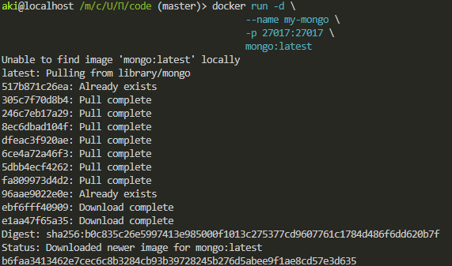
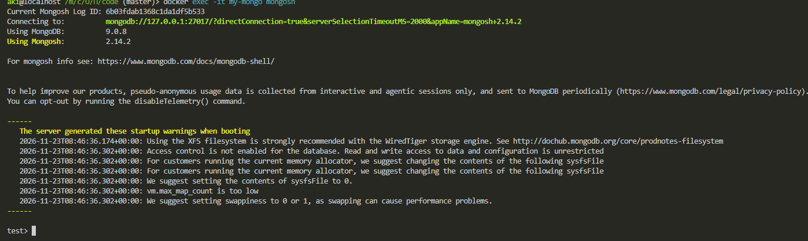
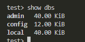
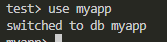
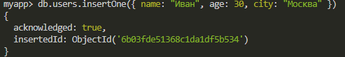
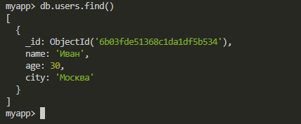
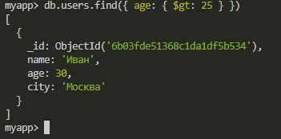
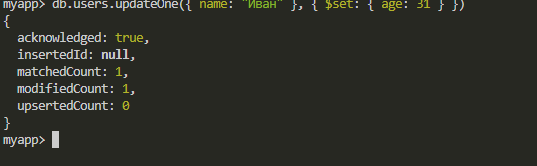
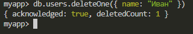
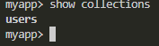

## MongoDB (NoSQL)

- > ## Для выполнения этого задания используйте WSL или любой другой Linux или Mac!

Выполните все этапы работы с проектом по примеру с [Nginx](/content/Docker/ImageLibrary/Nginx.md)

- > Никогда в разработке не используйте русские имена файлов и каталогов!
- > Никогда в разработке не используйте пробелы и спец.символы в именах файлов и каталогов!
- > Перед созданием проекта убедитесь, что порт, который собираетесь использовать не занят другим приложением!
- > Создание проекта лучше начать с "чистого листа", предварительно остановив и удалив все другие контейнеры и образы!

### 1. Подготовка

> **Создание проекта лучше начать с "чистого листа", предварительно остановив и удалив все другие контейнеры и образы!**

Перед выполнением этого задания рекомендуется завершить и удалить все имеющиеся учебные контейнеры:

Остановить все запущенные контейнеры:
```shell
docker stop $(docker ps -q)
```
Удалить все остановленные или не запущенные (Exited, Created) учебные контейнеры:
```shell
docker container prune
```
> **Prune** — удаляйте ненужные контейнеры, чтобы не засорять ваш Docker!

Или так удалить все учебные контейнеры (включая запущенные — принудительно):
```shell
docker rm -f $(docker ps -aq)
```
Очистить все ненужные (учебные) тома:
```shell
docker volume prune -a
```
Опционально: можно удалить образы и кеш сборок в Docker

Удаление всех образов
```shell
docker image prune -a
```
Очистить кэш всех сборок:
```shell
docker builder prune -a
```

- [Подробней про управление Docker в шпаргалке](/content/Docker/DockerReminder.md)

***

### 2. Получение и запуск MongoDB

**Git-Bash/Linux/WSL 2.0/Mac**:
```shell
docker run -d \
  --name my-mongo \
  -p 27017:27017 \
  mongo:latest
```


Подключиться через shell:
```shell
docker exec -it my-mongo mongosh
```



### 3. Выполнить несколько команд в базе данных MongoDB

Посмотреть текущие базы данных:
```shell
show dbs
```


Создать/переключиться на базу:
```shell
use myapp
```


Создать коллекцию и вставить документ:
```shell
db.users.insertOne({ name: "Иван", age: 30, city: "Москва" })
```


Найти документы:
```shell
db.users.find()
```


Найти с фильтром:
```shell
db.users.find({ age: { $gt: 25 } })
```


Обновить документ
```shell
db.users.updateOne({ name: "Иван" }, { $set: { age: 31 } })
```


Удалить документ
```shell
db.users.deleteOne({ name: "Иван" })
```


Посмотреть коллекции
```shell
show collections
```


Выйти
```shell
exit
```

