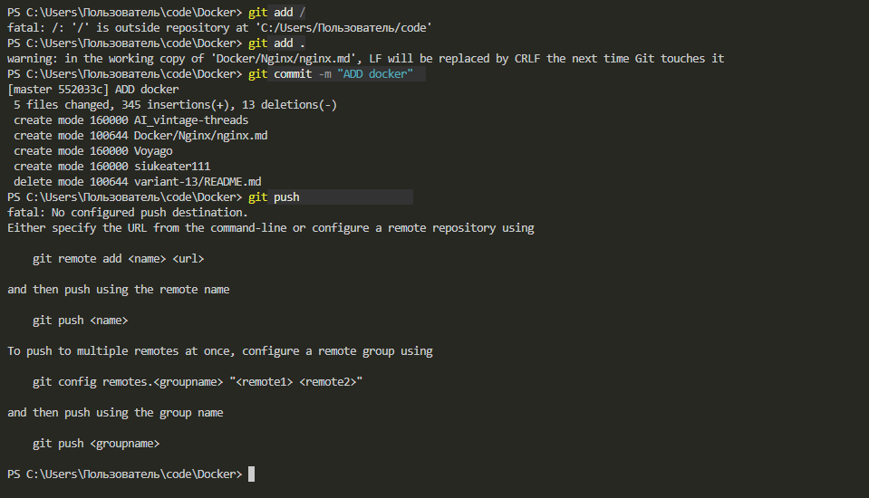
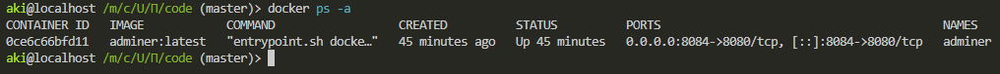
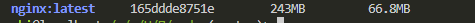
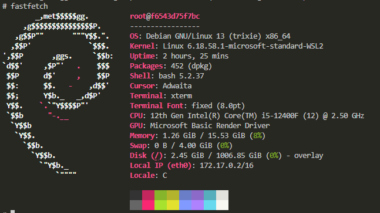
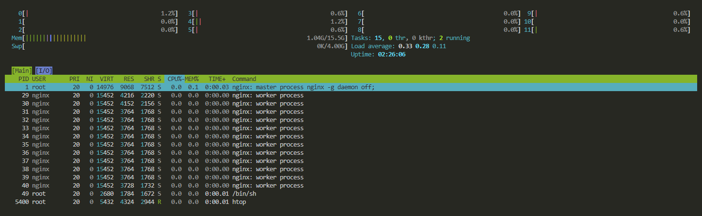
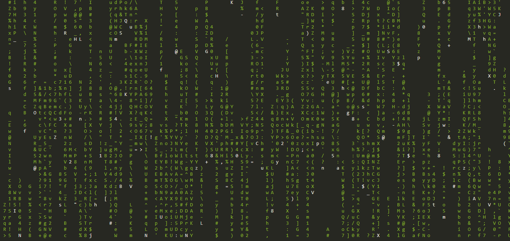
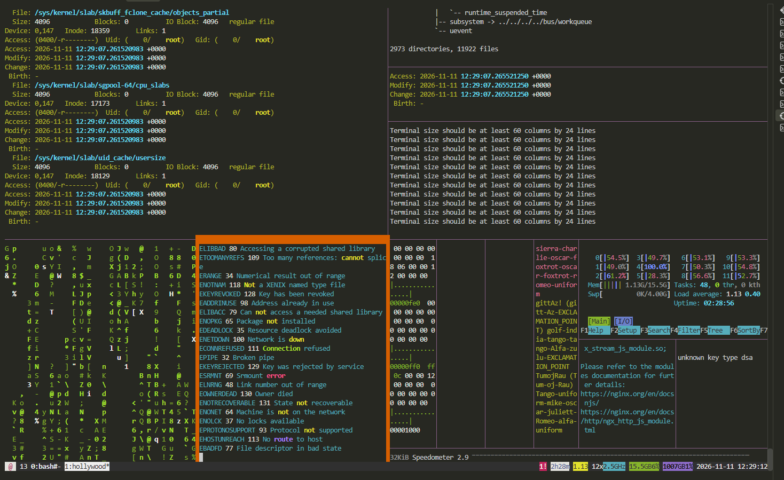

# Лабораторная работа: запуск и настройка веб-сервера Nginx в Docker

**Цель работы:** познакомиться с основными командами Docker, загрузить
готовый образ Nginx, запустить веб-сервер в контейнере и проверить его
работу.

**Среда выполнения:** операционная система Windows с использованием WSL 2 (Ubuntu). Все команды Docker выполнялись через терминал Linux.

## 1. Проверка установки Docker

Перед началом работы необходимо убедиться, что Docker установлен и
доступен в командной строке. Для этого откройте терминал WSL и выполните:

``` bash
docker version
```

Команда выводит сведения о клиенте и серверной части Docker. Если версии
отображаются без ошибки подключения, значит Docker готов к работе.




## 2. Проверка текущих контейнеров и образов

Перед созданием нового контейнера полезно посмотреть, какие контейнеры
уже существуют:

``` bash
docker ps -a
```

Команда `docker ps` показывает только запущенные контейнеры, а параметр
`-a` добавляет в список остановленные.

Если в списке есть старые учебные контейнеры, которые больше не нужны,
их можно остановить и удалить по отдельности. Например:

``` bash
docker stop имя_контейнера
docker rm имя_контейнера
```

Чтобы посмотреть имеющиеся образы, используйте:

``` bash
docker images
```

**Важно:** не удаляйте все контейнеры и образы без проверки. В них могут
находиться данные других проектов. Для этой работы достаточно освободить
только те ресурсы, которые мешают запуску контейнера с выбранным именем
или портом.



## 3. Поиск и загрузка образа Nginx

Nginx --- веб-сервер, который может отдавать браузеру страницы сайта. В
Docker для запуска приложения используется образ --- подготовленный
шаблон, на основе которого создаётся контейнер.

Найти доступные варианты образа можно командой:

``` bash
docker search nginx
```

Также образы публикуются на сайте Docker Hub: <https://hub.docker.com/>.

Для загрузки официального образа Nginx выполните:

``` bash
docker pull nginx
```

После завершения загрузки проверьте, появился ли образ на компьютере:

``` bash
docker images
```



## 4. Создание и запуск контейнера

Теперь создадим контейнер на основе загруженного образа:

``` bash
docker run -d --name my-nginx -p 8080:80 nginx
```

Значение параметров:

-   `run` --- создать контейнер и запустить его;
-   `-d` --- запустить в фоновом режиме;
-   `--name my-nginx` --- присвоить контейнеру имя;
-   `-p 8080:80` --- связать порт 8080 компьютера с портом 80 внутри
    контейнера;
-   `nginx` --- имя используемого образа.

В этой работе выбран порт **8080**, чтобы не занимать стандартный порт
80 на компьютере. Если Docker сообщает, что имя `my-nginx` уже
используется, проверьте список командой `docker ps -a` и при
необходимости удалите старый учебный контейнер.

Проверить состояние запущенного контейнера можно так:

``` bash
docker ps
```

[Фото вывода ps](04-running-container.png)

## 5. Проверка веб-сервера в браузере

Откройте браузер и перейдите по адресу:

<http://localhost:8080/>

Если всё настроено правильно, появится стандартная приветственная
страница Nginx.

При желании ответ сервера можно проверить и из терминала:

``` bash
curl http://localhost:8080/
```

[фОТО ВЫВОДА](05-nginx-browser.png)

[ФОТО ВЫВОДА](06-curl-response.png)
## 6. Просмотр информации и журналов контейнера

Docker позволяет получить подробную информацию о контейнере:

``` bash
docker inspect my-nginx
```

Для просмотра потребления ресурсов запустите:

``` bash
docker stats my-nginx
```

Команда обновляет показатели в реальном времени. Завершить просмотр
можно сочетанием `Ctrl+C`.

Посмотреть журнал работы Nginx можно командой:

``` bash
docker logs my-nginx
```

Чтобы наблюдать за новыми записями журнала в режиме реального времени,
используйте:

``` bash
docker logs -f my-nginx
```

Для выхода из режима просмотра нажмите `Ctrl+C`.

[ФОТО](07-container-stats.png)

[ФОТО](08-container-logs.png)

## 7. Подключение к командной оболочке контейнера

Можно открыть терминал непосредственно внутри работающего контейнера:

``` bash
docker exec -it my-nginx /bin/sh
```

После входа команды выполняются уже внутри контейнера. Например, чтобы
посмотреть сведения о системе, выполните:

``` bash
uname -a
```

Дополнительные сведения о дистрибутиве можно получить командой:

``` bash
cat /etc/os-release
```

Чтобы вернуться в обычный терминал компьютера, введите:

``` bash
exit
```

[ФОТО](09-container-system.png)

## 8. Запуск дополнительных программ внутри контейнера

Внутри контейнера можно установить несколько консольных утилит, чтобы
познакомиться с дополнительными возможностями Linux. Для этого снова
откройте оболочку контейнера из терминала WSL:

``` bash
docker exec -it my-nginx /bin/sh
```

Установите набор программ:

``` bash
apt update && apt install -y fastfetch htop inxi cmatrix hollywood caca-utils mc micro
```

После завершения установки запускайте программы по одной. Все команды
ниже вводятся внутри контейнера, а не в обычном терминале WSL.

### Fastfetch — информация о системе

``` bash
fastfetch
```

Утилита показывает основные сведения о системе и окружении контейнера.



### Htop — просмотр процессов

``` bash
htop
```

Программа отображает запущенные процессы и использование ресурсов.
Для выхода нажмите `Q`.



### Cmatrix — анимация в стиле «Матрицы»

``` bash
cmatrix
```

Команда запускает анимацию символов в терминале. Для завершения нажмите
`Q` или `Ctrl+C`.



### Hollywood — имитация рабочего экрана хакера

``` bash
hollywood
```

Утилита открывает несколько динамических панелей в терминале. Для выхода
нажмите `Ctrl+C`.



После просмотра программ можно выйти из контейнера:

``` bash
exit
```

## 9. Изменение стартовой страницы Nginx

Стандартную страницу веб-сервера можно заменить собственной. Для этого
снова войдите в контейнер:

``` bash
docker exec -it my-nginx /bin/sh
```

Файл главной страницы находится по пути:

``` micro
/usr/share/nginx/html/index.html
```

Если в контейнере есть текстовый редактор `vi`, откройте файл:

``` bash
vi /usr/share/nginx/html/index.html
```

Замените содержимое, например, на следующий HTML-код:

``` html
<!DOCTYPE html>
<html>
<head>
    <meta charset="UTF-8">
    <title>Приветственная страница index.html</title>
</head>
<body>
    <h1>Привет из контейнера Димаса index.html! 🐳</h1>
    <p>Здесь может быть любой русский текст.</p>
</body>
</html>
```

Сохраните изменения и выйдите из редактора. В `vi` для этого нажмите
`Esc`, введите `:wq` и нажмите `Enter`.

После этого обновите страницу в браузере по адресу
<http://localhost:8080/>. Должен отобразиться новый текст.

[фото](10-custom-nginx-page.png)

Вставьте скриншот браузера с вашей изменённой страницей. На снимке
должен быть виден заголовок «Мой первый сайт в Docker!».

## 10. Управление состоянием контейнера

Основные команды для управления контейнером:

Остановить работу:

``` bash
docker stop my-nginx
```

Запустить остановленный контейнер:

``` bash
docker start my-nginx
```

Перезапустить контейнер:

``` bash
docker restart my-nginx
```

После остановки контейнера страница по адресу `http://localhost:8080/`
перестанет открываться. После команды `docker start my-nginx` веб-сервер
снова станет доступен.

Проверить состояние контейнера можно командой:

``` bash
docker ps -a
```

[фото](11-container-management.png)

Добавьте скриншот после выполнения команд управления и проверки через
`docker ps -a`. Желательно, чтобы на нём было видно состояние
контейнера.

## 11. Завершение работы

Когда проверка закончена, остановите контейнер:

``` bash
docker stop my-nginx
```

Если контейнер больше не понадобится, его можно удалить:

``` bash
docker rm my-nginx
```

При необходимости удалить и сам образ можно после проверки, что он не
используется другими проектами:

``` bash
docker rmi nginx
```

Удаление контейнера и образа --- необязательный этап. Если планируется
продолжить работу с Nginx, их можно оставить.

## Вывод

В ходе лабораторной работы я познакомился с основными возможностями
Docker и научился работать с готовыми образами. Я загрузил образ Nginx,
создал на его основе контейнер и проверил доступность веб-сервера через
браузер. Также я изучил команды просмотра состояния, журналов и ресурсов
контейнера, попробовал подключиться к его командной оболочке и изменить
стартовую HTML-страницу.

Таким образом, я получил практический опыт запуска и базового управления
веб-сервером Nginx в Docker.
